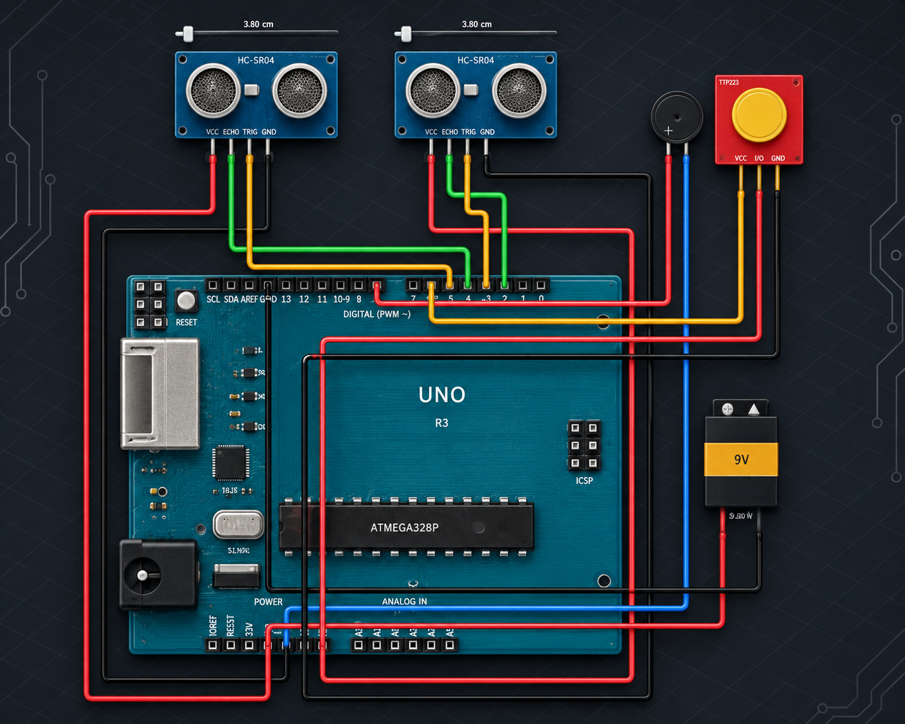

# Assistive Obstacle Detection System

An Arduino-based assistive technology project designed to help visually impaired individuals detect nearby obstacles and receive real-time alerts for safer navigation.

## 📌 Overview

Navigating unfamiliar environments can be challenging for visually impaired individuals. This project aims to provide a simple and affordable assistive solution that detects nearby obstacles using sensors and alerts the user through audio signals.

The system continuously monitors the surroundings and provides alerts when an obstacle is detected.

## 🎯 Objectives

- Detect nearby obstacles using sensors.
- Provide real-time alerts when obstacles are detected.
- Support safer and more independent movement.
- Develop an affordable assistive technology solution.

## ⚙️ How It Works

1. Sensors continuously monitor the surrounding environment.
2. When an obstacle is detected within the sensing range, the Arduino processes the sensor input.
3. The system activates an alert mechanism.
4. The user receives an indication of the detected obstacle.

## 🛠️ Hardware Components

- Arduino
- Obstacle detection sensors
- Buzzer
- Connecting wires
- Power supply

## 🔌 Circuit Diagram

The circuit diagram illustrates the hardware connections between the Arduino, sensors, and alert components.

<!-- Add your circuit diagram below -->

## ✨ Features

- Real-time obstacle detection
- Sensor-based monitoring
- Audio alert mechanism
- Simple and affordable hardware implementation
- Designed for assistive mobility applications

## 🚀 Future Improvements

- Improve obstacle detection accuracy and range.
- Add voice-based alerts.
- Integrate multiple sensors for better environmental awareness.
- Explore distance-based and directional alerts.
- Develop a more compact and wearable design.

## ⚠️ Disclaimer

This project is an experimental prototype developed for educational purposes. It is not a certified mobility aid and should not replace a white cane, guide dog, or other established mobility assistance methods.

## 👩‍💻 Author

**Papia Karmakar**

B.Tech Computer Science and Engineering Student

- GitHub: [@Papia-tech](https://github.com/Papia-tech)

---

⭐ If you find this project interesting, consider giving the repository a star!
